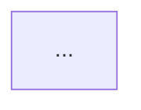

# PR description

A PR description is read three times:

- by the reviewer deciding whether to open the diff;
- by the person six weeks later asking why the invoice or the editor behaves like this;
- by whoever searches merged PRs for the reason behind a change.

Write for all three. Put the high-level view first and a picture before a paragraph. Leave the mechanism at the bottom, where only the reviewer scrolls.

EasyInvoicePDF is a Next.js app that renders the invoice PDF in the browser. Most changes are visible, either in the editor or in the PDF itself, so a description without a picture or clip is a claim the reader has to take on trust. This skill makes the evidence.

## Workflow

1. **Read the change against `origin/main`.**
   - Run `git fetch origin` first. A local `main` can sit commits behind, and comparing against it lists already-merged work and photographs an old "before".
   - `git log --oneline origin/main..HEAD` and `git diff origin/main...HEAD` show committed work.
   - `git diff HEAD` shows uncommitted edits. When HEAD equals `origin/main`, this is the whole change.
   - `git status --short` lists untracked files (`??`), which no diff shows. Read new files directly.
   - Read any linked issue, and the conversation, for the why.
   - Decide which template from `references/templates.md` fits. Read only that one.
2. **Check the branch is shippable.**
   - Not on `main`. If you are, branch first: `git switch -c <short-kebab-name>`.
   - The pre-commit gate passes: `pnpm type-check:fast`, `pnpm lint`, `pnpm knip` and `pnpm vitest --run`. Run the e2e tests the change touches, narrowed as `CLAUDE.md` describes, not the whole suite.
   - A change to what `/`, `/stripe-template` or `/[locale]/about` shows has had the `update-screen-atlas` skill run.
   - Uncommitted work is either committed or deliberately left out; ask if unclear. Follow `CLAUDE.md`'s working agreements: stage only the files the change touched (never `git add -A`), write a Conventional Commit message, and let the pre-commit hook run (never `--no-verify`). Leave staging you didn't cause alone.
   - Agent tooling under `.claude/` (skills, `launch.json`) is not part of an app change. Point it out if it's in the diff, and suggest its own PR or its own 🛠️ section.
3. **Capture media.** Follow [Capturing media](#capturing-media): before/after PNGs, plus one MP4 + GIF for anything that moves.
4. **Write the title and body.** Follow [Title](#title) and [What every body carries](#what-every-body-carries). Write the body to `<media dir>/body.md`, next to the media. gh resolves relative image paths from the body file's folder.
5. **Show the user before pushing.** Give them the title, the body path and the media list. Pushing and opening a PR are visible to others, so get a yes first, unless the user has already said to open it.
   - Also tell them anything the captures revealed that the PR didn't intend, such as a wrapped label, an overlap, a console error or a PDF line that moved. Say it in your message, not only under Risks, so they can fix it first.
6. **Push and open (or update).**

   ```bash
   git push -u origin HEAD
   gh pr create --base main --title "<title>" --body-file "$MEDIA/body.md" \
     --attach "$MEDIA/after.png" --attach "$MEDIA/before.png" \
     --attach "$MEDIA/<clip>.mp4" --attach "$MEDIA/<clip>.gif"
   ```

   - If the branch already has a PR (`gh pr view --json number,url`), use `gh pr edit <number> --title … --body-file … --attach …` instead.
   - Pass every referenced file once, and nothing else: no scenario JSONs, no check frames. gh rewrites each local reference to the uploaded URL. Any file you attach but don't reference is appended to the end of the body.
   - The alt text written in the Markdown is kept, so a plain `--attach "$MEDIA/after.png"` is enough. Skip the `#alt` suffix and its quoting.

7. **Verify, then clean up.**
   - Run `gh pr view --json body -q .body | grep -c 'user-attachments'`. It should count one URL per attached file.
   - Also check that no `](./` local paths remain.
   - Only then run `rm -rf "$MEDIA"`. If any upload failed, keep the folder, say which file failed, and retry with `gh pr edit --attach`.
8. **Report** the PR URL, and what the reviewer should look at first.

## Title

The repo uses Conventional Commits for PR titles, because squash-merging turns the title into the commit on `main`. After the prefix, say what a user now gets, not what the diff did. Keep it lowercase after the colon (except proper nouns) and under about 70 characters.

- ✅ "feat: add a screen atlas of every app state and flow"
- ✅ "fix: keep the first letter of every label in generated PDFs"
- ✅ "feat(analytics): richer download_invoice metadata"
- ❌ "feat: update invoice-form.tsx and schema"
- ❌ "Add night mode" (no type prefix)

Types in use: `feat`, `fix`, `perf`, `refactor`, `docs`, `test`, `ci`, `chore`, with `(deps)` or another scope when it narrows things down.

## What every body carries

The body has two layers. **Above the fold** is what everyone reads: the summary, a few change sections, the screenshots and the diagram. **Collapsed below** is what only the reviewer needs: risks and the technical overview. A long description isn't more thorough, it's harder to review. So keep the visible part within the budget below, and move detail into the collapsed block instead of deleting it.

**Size the body to the PR.** Count the words outside `<details>`:

- **A small fix or polish:** about 150 words. Often there are no change sections at all, just the summary, a screenshot and the reviewer block.
- **One feature:** about 300 words.
- **Several features in one PR:** about 500 words at most.

If you're over, cut in this order: a fact that appears twice, then sub-bullets, then whole sections.

**A summary first, before anything else.** It's the whole PR for someone who reads nothing further: a reviewer triaging their queue, or someone scanning merged PRs months later.

- Use a bold **Summary** label and two to four bullets. Give one bullet per headline change, the fixes and tooling included, so nothing in the PR is a surprise further down.
- Each bullet is one plain sentence about what a user or maintainer now gets. Put no file paths, test counts or mechanism here.
- If the PR needs one thing from the reviewer, such as "check the phone layout" or "decide on the default", make it the last bullet.
- Put the GIF, if there is one, straight under the bullets with no heading of its own. It autoplays, so a skimmer sees the change without clicking anything.

```markdown
**Summary**

- Saved buyers can be edited in place, without deleting and re-adding them.
- Long company names no longer push the tax ID onto a second line in the PDF.
- Please check the edit dialog on a phone; it's the part I'm least sure of.


```

**A contents list, only when there are five or more `##` sections.** A short body doesn't need one.

- GitHub gives headings in a PR body no anchors you can rely on. So end every linked heading with `<a id="slug"></a>`, and link to `#user-content-slug`. GitHub prefixes user ids with `user-content-`.
- A dead link is worse than none, so give every listed section an id.
- Write it as a bulleted list under a bold **Contents** label, one link per line, in section order. The last item points at the reviewer block, through the anchor placed just above `<details>`.

```markdown
**Contents**

- [Edit saved buyers](#user-content-buyers)
- [Screenshots](#user-content-shots)
- [How it works](#user-content-diagram)
- [Details for reviewers](#user-content-reviewers)
```

**Change sections: at most one per summary bullet, and at most four.**

- A summary bullet that is complete on its own gets no section. Write a section only when a reader needs more than the one sentence, such as how to reach the feature or what it saves.
- Give each section one emoji and a benefit heading, such as `## ✏️ Edit saved buyers`. For housekeeping PRs, use a change class instead: ✨ Feature · 🐛 Fix · 💄 Polish · ♿ Accessibility · ⚡ Performance · 📝 Docs · 🧪 Tests · ♻️ Refactor.
- Don't open by repeating the summary sentence. Start with what the summary left out.
- Each bullet is one line: a bold hook, a dash, the fact. Add an indented sub-bullet only for something a reader will use, such as a menu path (Buyer › Saved buyers › Edit), a setting or a number. Use two at most.
- Fold small related changes into one bullet instead of giving each its own.
- When the change touches something users rely on (saved invoices, share links, PDF layout), add one bullet saying what stayed the same. Check that claim against the diff: "untouched" is the line reviewers catch.
- Credit contributors inline: "Thanks @handle (#NN)".
- Use no file paths, function names or line numbers outside the reviewer block.

**Screenshots, in one section.**

- Include at least one PNG of the screen after the change.
- Add a before/after pair when the change replaces something, laid out as a two-column table so they sit side by side.
- Crop to the part that changed. A change to the buyer section shows that section, not the whole editor; a PDF change shows the PDF preview, not the form.
- Keep crops under about 4:1. For a full-width bar, crop an inner element or take that shot at a narrower viewport. A 5000×200 strip renders as a sliver on GitHub.
- Keep alt text to about ten words that say what the picture shows.
- The MP4, if there is one, goes here too. Video is covered under [Capturing media](#capturing-media).
- A change with nothing to see, such as a test-only or tooling PR, shows terminal output in a fenced block instead and says why there is no screenshot.

```markdown
| Before                                           | After                              |
| ------------------------------------------------ | ---------------------------------- |
|  |  |
```

**A mermaid diagram of the change**, in a ` ```mermaid ` fence under `## How it works`, which GitHub renders inline. It stays above the fold, because a picture of the flow is quicker to read than the paragraph it replaces.

- Draw the change, not the whole app: the new flow, the state that moved, the modules touched. Aim for a dozen nodes or fewer.
- Shapes that fit most PRs here:
  - `flowchart` for data flow, such as form → debounce → `localStorage` → PDF, or which module now owns what.
  - `stateDiagram-v2` for UI state, such as a dialog's lifecycle or a saved party's states.
  - `sequenceDiagram` for timing, such as hydration from `?data=`, PDF regeneration or the server route's email-and-upload chain.

**Details for reviewers, collapsed.** Risks and the technical overview go last, inside `<details>`, so they cost nothing for a reader who doesn't open them.

- Put `<a id="reviewers"></a>` on its own line just above `<details>`, so the contents list can link to it.
- Leave a blank line after `<summary>…</summary>`, or GitHub won't render the Markdown inside.
- Use `###` headings inside. They don't go in the contents list.
- Screenshots beyond the main before/after pair, such as phone layouts, the second PDF template or close-ups, can go here under `### More screenshots`. That keeps the visible section to the pictures everyone needs.

**Risks**, inside the block.

- Lead with what is **not** checked, or what needs the reviewer's eye. Those are the bullets that matter.
- Then give one line per area that was checked, with the check: "Layout: checked at 375, 768 and 1440px wide."
- Cover the areas in the order a reviewer worries:
  1. Can this break the invoice: a wrong total, a missing line, a dropped character, a PDF that fails to render? Both templates (default and Stripe)?
  2. Can it break users' data: `localStorage` or saved sellers/buyers written by an older version, old `?data=` share links, a schema field missing from `INVOICE_KEY_COMPRESSION_MAP`?
  3. Can it break the build or deploy: a missing translation key in `messages/*.json` or the PDF catalog, an env var, a dependency pinned on purpose (react-pdf, fontkit)?
  4. Layout on phone and tablet widths, in the editor and the mobile PDF viewer.
  5. Accessibility: focus, labels, reduced motion.
  6. Privacy: does any invoice data now leave the browser (analytics properties, a new request)?
- Six bullets at most. Skip an area the PR can't touch.

**Technical overview**, inside the block, last.

- Explain the mechanism in three sentences at most.
- List only the files a reviewer should read closely, with a clause each. The diff already lists every file.
- Name the approach you rejected that they would ask about.
- Give the gate, for example "`pnpm vitest --run`: 1414 pass; `type-check:fast`, `lint`, `knip` clean; e2e `invoice-form.test.ts` on Desktop Chrome".

**Attribution.** End with any attribution line your environment asks for, after `</details>`.

## Capturing media

`scripts/capture.mjs` drives headless Chrome over the DevTools protocol, with no npm install. It needs Node 22+, Google Chrome (or `CHROME=/path`) and ffmpeg.

- Point it at a running dev server with `--url`. (`--dir` serves a static folder instead; it is not used for this app.)
- It writes PNGs at 2x, and turns each recording into an MP4 and a GIF.

**Set up a media folder** outside the repo, so nothing gets committed by accident:

```bash
MEDIA=$(mktemp -d)/pr-media && mkdir -p "$MEDIA/scenarios" "$MEDIA/checks"
```

Scenarios go in `$MEDIA/scenarios/`, and frames you extract to check a clip go in `$MEDIA/checks/`. Only media the body references sits at the top level, which keeps the attach list obvious.

**After** shots come from this checkout's dev server. Port 3000 is often another session's or worktree's server, so check first: `lsof -iTCP:3000 -sTCP:LISTEN -n -P`, then compare that process's working directory (`lsof -p <pid> | grep cwd`) with this checkout. If it's not this checkout, start one on another port with `PORT=3100 pnpm dev` (run it in the background), and wait until it answers.

```bash
node .claude/skills/pr-description/scripts/capture.mjs --url http://localhost:3100 --scenario "$MEDIA/scenarios/after.json" --out "$MEDIA"
```

**Before** shots come from `origin/main` (fetched in step 1), run from a throwaway worktree on its own port. A fresh worktree has no `.env.local`, so copy it in (and `.env.keys`, if the main checkout has one):

```bash
BASE=$(mktemp -d)/base && git worktree add --detach "$BASE" origin/main
cp "$(git rev-parse --show-toplevel)"/.env.local "$BASE"/ 2>/dev/null
(cd "$BASE" && pnpm install --frozen-lockfile && PORT=3101 pnpm dev)   # in the background
node .claude/skills/pr-description/scripts/capture.mjs --url http://localhost:3101 --scenario "$MEDIA/scenarios/before.json" --out "$MEDIA"
# stop that dev server, then:
git worktree remove --force "$BASE"
```

If `.env.local` lives only in the main checkout and is encrypted with dotenvx, the worktree needs the same private key; when that's not available, fall back to `--url https://easyinvoicepdf.com` for the before shots. Production deploys from `main`, but say in the PR that the before shots came from production, and expect them to lag by any unreleased commits.

A before scenario runs against the old code, so it can't wait for selectors or storage keys the PR adds. Use a plain `{ "wait": 1500 }`, or an element that already existed.

**The scenario** is a JSON file you write for each PR. It drives the page to the state worth showing:

```json
{
  "viewport": [1440, 900],
  "scale": 2,
  "path": "/",
  "storage": { "EASY_INVOICE_CTA_LAST_SHOWN_AT": "9999999999999" },
  "steps": [
    {
      "waitFor": "document.querySelector('a[href^=\"blob:\"]')",
      "timeout": 20000
    },
    { "wait": 800 },
    { "screenshot": "after.png" },
    {
      "screenshot": "after-buyer.png",
      "selector": "#buyer-section",
      "pad": 24
    },
    {
      "record": "edit-buyer",
      "steps": [
        { "click": "button[aria-label='Edit buyer']" },
        { "wait": 600 },
        { "eval": "document.querySelector('#buyer-name').focus()" },
        { "wait": 1500 }
      ]
    }
  ]
}
```

The selectors above are placeholders: read the components for the real ones, or reuse the locators in `e2e/` and `scripts/page-atlas/capture/`.

**Steps:**

| Step       | Fields                                                                                                                                                        |
| ---------- | ------------------------------------------------------------------------------------------------------------------------------------------------------------- |
| Wait       | `wait` (ms), or `waitFor` (a JS expression) with an optional `timeout` (default 5000)                                                                         |
| Interact   | `click` (a CSS selector), `hover` (a CSS selector, for hover styles), `key` (`Space`, `Enter`, `Escape`, `Tab`, arrows…) with `hold` (ms), or `eval` (any JS) |
| Screenshot | `screenshot` (a file name); add `selector` and `pad` to crop                                                                                                  |
| Record     | `record` (a base name) with nested `steps`; writes `<name>.mp4` and `<name>.gif`                                                                              |

**Scenario notes:**

- **Wait for the PDF.** The download link gets a `blob:` href once the PDF has rendered, so `document.querySelector('a[href^="blob:"]')` is the ready signal; give it a 20s timeout on a cold dev server. Without it, a skeleton or a half-drawn preview lands in the PR.
- **Seed realistic invoice data.** `storage` sets `localStorage` before the page loads. The keys are the `*_STORAGE_KEY` constants in `src/app/schema/index.ts`: `EASY_INVOICE_PDF_DATA` holds the invoice (JSON matching `invoiceSchema`), and the sellers/buyers keys hold saved parties. Alternatively set `path` to a `/?data=…` share link, which the app hydrates from: build one in the running app with the share button. Realistic names and a few line items read better than the defaults.
- **Silence what isn't the change.** Seed `EASY_INVOICE_CTA_LAST_SHOWN_AT` to a far-future timestamp so the CTA toast stays away, and any other popup key the current `main` still has.
- **Edits are debounced.** A form change reaches the PDF after `DEBOUNCE_TIMEOUT` (500ms) plus a re-render, so wait about 1500ms after typing before shooting the preview.
- **The Stripe template** lives at `/stripe-template` (or `template: "stripe"` in the seeded data). A change to one PDF template usually needs a shot of the other.
- The viewport is set once per scenario, so a phone shot needs its own scenario file with `"viewport": [375, 812]`, which also switches on mobile emulation. Add one whenever layout changed. On a phone the PDF is in its own tab of the mobile dock.
- For a PDF change, a close crop of the preview usually beats a full-page shot. If the preview is too small to read, render the downloaded PDF the way `e2e/utils/render-pdf-on-canvas.ts` does and crop that instead.
- Keep clips to 3–6 seconds of the one action that matters. The script prints each file's size and warns over GitHub's 10 MB limit. If you get the warning, shorten the clip, or lower `gifWidth` and `gifFps` on the record step (defaults 720 and 12).
- `--recorder native` records a steady 60 fps, but only at 1x. Keep the default recorder here, where sharp text matters more than smooth motion; reach for native only for an animation-heavy change. If Chrome lacks the recording call, the script warns and uses the default recorder.

**Look at every image before using it.** Open the PNGs, and pull a few frames from each MP4 into `$MEDIA/checks/`, for example `ffmpeg -ss 1 -i "$MEDIA/clip.mp4" -frames:v 1 "$MEDIA/checks/clip-1s.png"`. A screenshot of the wrong state is worse than none. Anything odd you spot is a finding for the user (step 5).

**Where video goes:**

- The GIF goes straight under the summary bullets, because it autoplays.
- The MP4 goes in **Screenshots**, under its own small bold label, as `` alone on its own line, with a blank line above and below. That's what makes GitHub render a player rather than a link. Video takes no alt text.
- Images take alt text in the Markdown. Describe what the picture shows, not that it is a screenshot.

## Body skeleton

This is the largest shape: a multi-feature PR. Drop what the PR doesn't need, and check the visible word count against the budget.

````markdown
**Summary**

- <Headline change, as what a user now gets.>
- <Next change, or the one thing you need from the reviewer.>


**Contents**

- [<Benefit 1>](#user-content-b1)
- [Screenshots](#user-content-shots)
- [How it works](#user-content-diagram)
- [Details for reviewers](#user-content-reviewers)

## 🎯 <Benefit 1> <a id="b1"></a>

- **<Hook>** – <the fact the summary left out>
- **<Hook>** – <fact>
  - <menu path, setting or number, only if the reader will use it>

## Screenshots <a id="shots"></a>

| Before                 | After                 |
| ---------------------- | --------------------- |
|  |  |

**<Clip name>**


## How it works <a id="diagram"></a>



<a id="reviewers"></a>

<details>
<summary><b>Details for reviewers</b>: risks and technical overview</summary>

### Risks

- **Not checked:** <what wasn't verified, or needs the reviewer's eye>
- **<Area>** – <the check that covers it>

### Technical overview

<Mechanism in three sentences at most.>

- `src/<file>` – <why a reviewer should read it closely>
- **Rejected:** <the approach a reviewer would ask about, and why not>
- **Gate:** `pnpm vitest --run` – <N> pass; `type-check:fast`, `lint`, `knip` clean

</details>
````

Always keep the summary, the screenshots (or their terminal-output stand-in), the diagram and the reviewer block. Everything else is earned by the PR's size.
